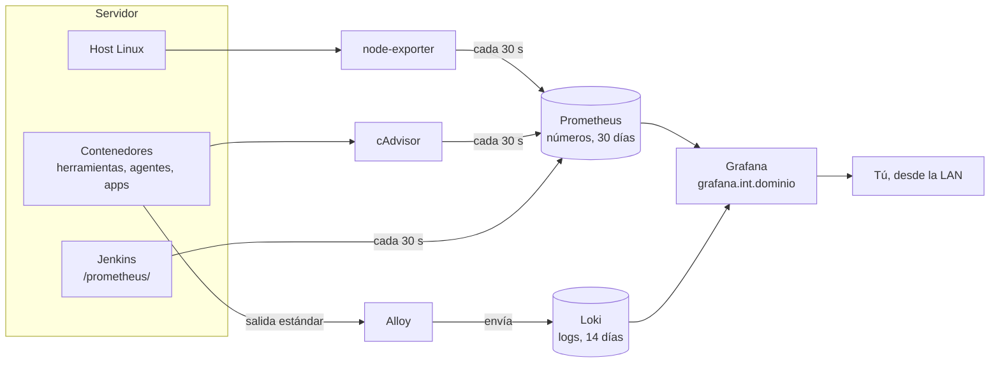

# Monitorización

Guía para quien llega al proyecto: qué se usa para vigilar el servidor, cómo funciona, cómo se mira y cómo se añade algo. El detalle técnico de cada pieza (destinos, etiquetas, retención, alertas) está en [arquitectura/11-observabilidad-y-backups.md](arquitectura/11-observabilidad-y-backups.md).

## En una frase

Prometheus guarda **números** (CPU, memoria, builds), Loki guarda **texto** (los logs de los contenedores) y Grafana es la **pantalla** donde se miran los dos. Nada de esto hay que configurarlo por app: un contenedor nuevo aparece solo.

## Qué se usa

| Pieza | Qué hace | Stack | Memoria |
|---|---|---|---|
| **node-exporter** | Expone las métricas del host Linux: CPU, RAM, discos, red, temperatura | `metrics` | 64 MB |
| **cAdvisor** | Expone el consumo de cada contenedor: CPU, memoria, red, arranques | `metrics` | 192 MB |
| **Prometheus** | Lee esas métricas cada 30 s, las guarda 30 días y evalúa las alertas | `metrics` | 512 MB |
| **Alloy** | Lee la salida de todos los contenedores y la envía a Loki | `logs` | 256 MB |
| **Loki** | Guarda los logs 14 días y permite buscarlos | `logs` | 512 MB |
| **Grafana** | Dashboards y búsqueda de métricas y logs | `grafana` | 384 MB |

Jenkins y el daemon de Docker exponen sus propias métricas, que Prometheus también lee: el plugin `prometheus` de Jenkins y `metrics-addr` en `daemon.json`.

## Cómo funciona

Dos ideas que explican casi todo lo que se ve:

- **Prometheus pregunta, Loki recibe.** Prometheus visita cada 30 s una lista fija de destinos (`prometheus.yml`). Alloy, en cambio, descubre los contenedores por la API de Docker y empuja sus logs a Loki. Por eso un contenedor nuevo no necesita configuración: cAdvisor ya lo mide y Alloy ya lo lee.
- **Si el servidor está apagado no hay datos.** Las horas de apagado salen como huecos en las gráficas. No es un error.

Los tres stacks se levantan con `./mercury up monitoring` y se detienen con `./mercury down monitoring`, que libera 1,9 GB. Instalación: [instalacion/02-puesta-en-marcha.md](instalacion/02-puesta-en-marcha.md#fase-6-monitoring).

## Entrar en Grafana

`https://grafana.int.<dominio>`, usuario y contraseña de `stacks/monitoring/grafana/.env` (`GRAFANA_ADMIN_USER`, `GRAFANA_ADMIN_PASSWORD`).

La página de inicio de Grafana invita a "crear tu primer dashboard" aunque ya existan: **los dashboards están en ☰ > Dashboards > carpeta *Mercury***. Cada dashboard de Mercury tiene arriba el enlace *Mercury* para saltar a los demás conservando el rango de tiempo.

## Los dashboards

Los cuatro primeros son del repo. Los tres de la comunidad los descarga `fetch-dashboards.sh` y no se versionan.

| Dashboard | Para responder a | Cuándo mirarlo |
|---|---|---|
| **Mercury - Host** | ¿Está bien el servidor Linux? | El servidor va lento, se reinició o se llena un disco |
| **Mercury - CI/CD** | ¿Funciona la plataforma? ¿Cómo van los builds? | Un build no arranca o tarda, o una herramienta no responde |
| **Mercury - Apps** | ¿Cómo está cada app desplegada? ¿Qué dicen sus logs? | Tras desplegar, o cuando una app falla |
| **Mercury - Resumen** | Vista rápida de todo | Primer vistazo del día |
| Node Exporter Full | Todo el detalle del host | Cuando *Host* no basta |
| Cadvisor exporter | Detalle por contenedor | Cuando *Apps* o *CI/CD* no bastan |
| Jenkins: Performance and Health Overview | Detalle de Jenkins y su JVM | Problemas del propio Jenkins |

Todos tienen una descripción por panel: pasa el ratón por el icono ⓘ junto al título.

### Mercury - Host

| Panel | Cómo leerlo |
|---|---|
| Encendido desde hace | Un valor bajo que no esperabas es un reinicio o un corte de luz |
| CPU, Carga por núcleo | Carga por encima de 1 de forma sostenida: hay más trabajo que núcleos |
| RAM usada, Swap usada | El límite real son los 12 GB. RAM por encima del 85 % o swap creciendo: sobra algún servicio (`./mercury down sonarqube` libera 3,5 GB) |
| Temperatura CPU | Por encima de 80 °C sostenidos: polvo o ventilación |
| CPU por modo | *iowait* alto significa que la CPU espera al disco |
| Uso de sistemas de archivos | `/` es el SSD (`DATA_DIR`), `/mnt/hdd` el HDD. Alerta al 85 %: `./mercury prune` en el SSD |
| Lectura y escritura, Ocupación del disco | Ocupación cerca del 100 % sostenida: el disco es el cuello de botella |
| Tráfico de red, Temperatura por núcleo | Contexto para lo anterior |

### Mercury - CI/CD

| Panel | Cómo leerlo |
|---|---|
| Jenkins | *CAÍDO*: `./mercury logs jenkins` |
| Servicios en marcha | Cuenta 9 contenedores: `jenkins`, `socket-proxy`, `sonarqube`, `sonar-db`, `registry`, `registry-ui`, `npm`, `adguard` y `cloudflared`. Si faltan, la barra del que falta desaparece de *Memoria respecto a su mem_limit*. Con SonarQube apagado a propósito, 7 es lo normal |
| Builds en cola | Builds esperando agente. Si se queda alto sin agentes en marcha, revisa la etiqueta del Jenkinsfile y `JENKINS_MAX_AGENTS` |
| Agentes en marcha, Escáneres en marcha | Contenedores efímeros: valen 0 cuando no hay builds |
| Destinos de Prometheus caídos | Mayor que 0: Prometheus no puede leer alguna fuente (alerta `ObjetivoCaido`) |
| Último build por job | Resultado, duración, hace cuánto y salud de cada job. **ABORTADO** incluye rechazar *Aprobar prod* y los builds cancelados por uno más nuevo |
| Builds iniciados por job | Actividad de la última hora |
| Contenedores de build en marcha, Memoria de agentes y escáneres | Qué agente se usó y cuánto ocupó. Los escáneres corren fuera del límite del agente |
| Memoria respecto a su mem_limit, CPU por servicio | Una barra por encima del 90 % es candidata a subir su `mem_limit` |
| Errores en Jenkins, SonarQube, registry y proxy | Líneas de log con `error`, `severe`, `exception` o `fatal` |

### Mercury - Apps

Arriba hay dos controles:

- **App**: una, varias o todas. La lista se rellena sola con los contenedores cuya imagen es `.../apps/<app>:<tag>`, así que una app recién desplegada aparece al recargar el dashboard.
- **Buscar en logs**: texto o expresión regular que filtra el panel de logs, sin distinguir mayúsculas (`timeout`, `usuario 42`, `5\d\d`).

| Panel | Cómo leerlo |
|---|---|
| Apps en marcha | Imagen (la etiqueta es el número de build desplegado), tiempo en marcha, memoria y % de su límite (`APP_MEM_LIMIT`), CPU. Una app que no sale no está en marcha |
| Memoria | Si crece sin parar hasta el límite y luego cae, la app se reinició por falta de memoria |
| CPU, Red | Carga y tráfico de la app |
| Arranques | Cada despliegue cuenta uno. Varios seguidos sin haber desplegado: la app se está cayendo |
| Líneas de log, Líneas con error | Picos de errores tras un despliegue = algo cambió en esa versión |
| Logs | Las últimas líneas, de la más nueva a la más antigua. Clic en una línea para ver sus etiquetas |

## Buscar logs a mano (Explore)

☰ > **Explore**, fuente **Loki**, modo **Code**. Cada línea lleva las etiquetas `container` (`<app>-<env>`, `jenkins`...), `stack` (proyecto compose) y `service`.

| Para ver | Consulta |
|---|---|
| Todo lo de una app | `{container="mi-api-dev"}` |
| Dev y prod juntos | `{container=~"mi-api-(dev\|prod)"}` |
| Solo errores | `{container="mi-api-prod"} \|~ "(?i)(error\|exception\|fatal)"` |
| Contiene un texto | `{container="mi-api-dev"} \|= "usuario 42"` |
| Quitar ruido | `{container="mi-api-dev"} != "healthcheck"` |
| Logs en JSON, por campo | `{container="mi-api-dev"} \| json \| level="error"` |
| Todo un stack | `{stack="jenkins"}` |

**Live** (arriba a la derecha) sigue el log en tiempo real, como `docker logs -f`. Sin Grafana, desde el servidor: `docker logs -f --tail 100 <contenedor>`.

En Explore con la fuente **Prometheus** se consultan las métricas. En cAdvisor el contenedor va en la etiqueta `name`:

| Para ver | Consulta |
|---|---|
| Memoria de un contenedor | `container_memory_working_set_bytes{name="mi-api-prod"}` |
| % de su límite | `100 * container_memory_working_set_bytes{name="mi-api-prod"} / container_spec_memory_limit_bytes{name="mi-api-prod"}` |
| CPU (100 % = un núcleo) | `100 * rate(container_cpu_usage_seconds_total{name="mi-api-prod"}[5m])` |
| Qué destinos lee Prometheus | `up` (1 = bien, 0 = caído) |

## Alertas

Prometheus evalúa seis reglas (`stacks/monitoring/metrics/prometheus/rules/mercury.yml`): destino caído, RAM, swap, disco, contenedor que se reinicia y contenedor cerca de su límite. Se ven en Grafana > **Alerting > Alert rules**.

**Nadie recibe un aviso todavía**: no hay Alertmanager ni *contact point*. La vía más corta para recibirlos está en [instalacion/04-operacion-y-futuro.md](instalacion/04-operacion-y-futuro.md#alertas).

## Cómo se configura

Todo sale de archivos del repo, montados en solo lectura. Un cambio se aplica así:

| Quiero | Archivo | Cómo se aplica |
|---|---|---|
| Cambiar o añadir un dashboard propio | `stacks/monitoring/grafana/dashboards/<nombre>.json` | `git pull`; Grafana relee la carpeta cada 60 s, sin reiniciar |
| Actualizar los dashboards de la comunidad | `stacks/monitoring/grafana/fetch-dashboards.sh` | `bash stacks/monitoring/grafana/fetch-dashboards.sh` en el servidor |
| Añadir una alerta | `stacks/monitoring/metrics/prometheus/rules/mercury.yml` | `./mercury restart metrics` |
| Añadir un destino a Prometheus | `stacks/monitoring/metrics/prometheus/prometheus.yml` | `./mercury restart metrics` (y la red, ver abajo) |
| Cambiar qué mide cAdvisor | `--disable_metrics` en `stacks/monitoring/metrics/compose.yaml` | `./mercury up metrics` |
| Cambiar etiquetas de los logs | `stacks/monitoring/logs/alloy/config.alloy` | `./mercury restart logs` |
| Cambiar la retención | `--storage.tsdb.retention.*` en el compose de `metrics`; `retention_period` en la configuración de Loki | `./mercury up metrics` / `./mercury restart logs` |

### Crear o modificar un dashboard

Los dashboards del repo no se pueden guardar desde la interfaz (`allowUiUpdates: false`): el repo es la fuente de verdad. El ciclo es:

1. Abre el dashboard y edítalo en Grafana, o crea uno nuevo con *New > New dashboard*.
2. *Save* no está disponible en los del repo: usa *Export > Export as JSON* y copia el JSON.
3. Guárdalo en `stacks/monitoring/grafana/dashboards/<nombre>.json`. Pon un `uid` fijo y legible (`mercury-algo`) y la etiqueta `mercury` en `tags`, para que salga en el enlace *Mercury* de los demás.
4. Las fuentes de datos se referencian por uid fijo: `{"type": "prometheus", "uid": "prometheus"}` o `{"type": "loki", "uid": "loki"}`.
5. Commit, `git pull` en el servidor y espera un minuto.

Un dashboard creado en la interfaz y guardado ahí, sin pasar por el repo, vive en `DATA_DIR/grafana`: entra en el backup, pero no en git.

### Métricas propias de una app

Hoy de las apps se ve su consumo y sus logs, no lo que pasa dentro (peticiones por segundo, latencia por endpoint). Para tenerlo:

1. La app expone `/metrics` en el 8080 con la librería de su lenguaje: `prometheus-net` (.NET), Micrometer con Actuator (Spring), `prom-client` (Node), `prometheus_client` (Flask).
2. Prometheus está en `net-tools` y `net-obs`, no en las redes de apps. Hay que añadirle `net-apps-dev` y `net-apps-prod` en `stacks/monitoring/metrics/compose.yaml`. Eso le da acceso de lectura a las apps, que hoy no tiene: es una decisión de diseño, no solo un cambio técnico.
3. Añadir un `job` en `prometheus.yml` con destino `<app>-<env>:8080`.

## Problemas frecuentes

| Síntoma | Causa | Solución |
|---|---|---|
| Grafana pide crear un dashboard | Es la página de inicio | ☰ > Dashboards > *Mercury* |
| Un panel dice *No data* | Rango de tiempo sin datos (servidor apagado) o el servicio no existe | Amplía el rango; comprueba que el contenedor esté en marcha |
| Todo dice *No data* | Prometheus caído | `./mercury ps metrics`, `./mercury logs metrics prometheus` |
| Una app nueva no sale en *Mercury - Apps* | Su imagen no es `.../apps/<app>:<tag>`, o no se ha recargado el dashboard | Recarga; comprueba `docker ps` |
| Los logs de una app no salen | No escribe en la salida estándar (escribe a un archivo dentro del contenedor) | La app debe loguear a stdout/stderr: es lo que leen `docker logs` y Alloy |
| `Destinos de Prometheus caídos` > 0 | Un servicio parado o inaccesible | En el servidor: `docker exec prometheus wget -qO- localhost:9090/api/v1/targets` |
| Prometheus cerca de 512 MB en *CI/CD* | Demasiadas series | Desactivar métricas en cAdvisor, o subir su `mem_limit` contando la RAM |
| En Alloy, `400 ... timestamp too old` | Tras un reinicio reenvía líneas que Loki ya no acepta | Ninguna: es inofensivo |
